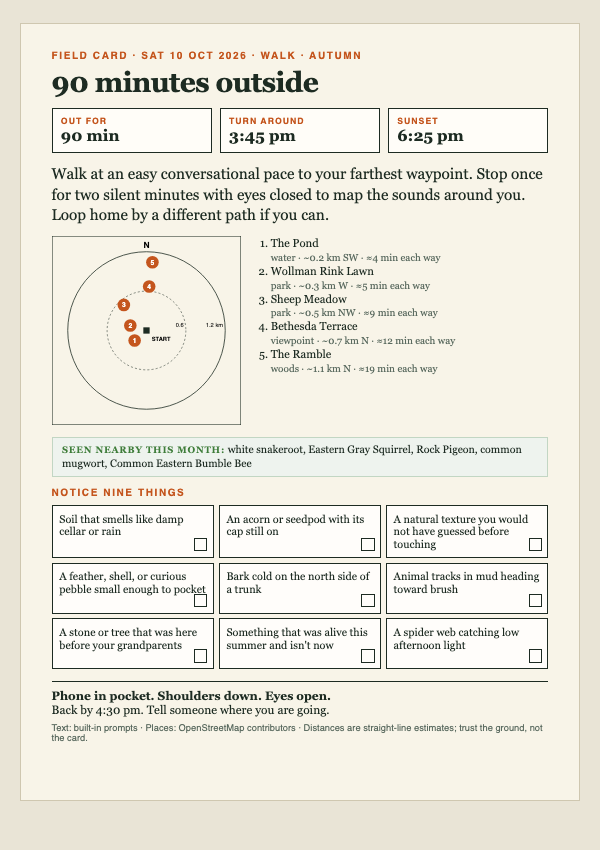

# Fieldcard

**The screen is the shortest part of the experience, so Fieldcard ends in paper.**

We reach for the phone to decide whether to go outside, then get trapped by notifications, feeds, and maps before ever stepping through the door. Fieldcard ends the screen at the printer: thirty seconds at a computer produces a tailored A5 field card with a seasonal mission, real terrain, and daylight safety math. You fold the card into your pocket, leave your phone behind, and walk into the physical world.



---

## Try it in 30 seconds

Fieldcard requires zero configuration and zero API keys.

### Option 1: The Local Web Doorway
```bash
python fieldcard.py serve
```
Open **`http://localhost:8000`** in any browser. Choose a one-click preset or your coordinates, pick your minutes, and hit **Generate Field Card**. Print the A5 card (or Save to PDF) and step outside. The page runs 100% locally on your machine with zero external assets.

### Option 2: The Command Line
```bash
# Generate a 90-minute autumn walk in Central Park:
python fieldcard.py --lat 40.7678 --lon -73.9718 --minutes 90 --activity walk

# Open fieldcard.html and print at A5
```

---

## Why open weights are the point

| Piece | Open component | What it does |
|---|---|---|
| **Text** | Any open-weight model via [Ollama](https://ollama.com) (default `llama3.2:3b`; also `gemma2:2b`, `qwen2.5:3b`) | Writes title, mission, and tactile 3×3 observation prompts grounded in your real terrain. |
| **Places** | [OpenStreetMap](https://www.openstreetmap.org) via Overpass | Parks, water, viewpoints, and peaks within your physical reach. |
| **Species** | [iNaturalist](https://www.inaturalist.org) Open API | Real flora and fauna species actively observed near you this month. |
| **Sun / Safety** | NOAA equations in plain Python | Deterministic sunset, turn-around times, and daylight warnings. |
| **Group QR** | Pure Python inline SVG | Zero-dependency, offline route code for running clubs (`--group`). |

Runs fully local after the first map lookup (results are cached in `~/.cache/fieldcard`). No API keys, no accounts, no credit cards, and zero telemetry.

**Design rule: the LLM writes the poetry, the code does the safety math.** Daylight warnings, turn-around times, and reach are computed deterministically. Model output is length-clipped, validated field-by-field, filtered of marketing cliches, and HTML-escaped. If Ollama or the network is down, Fieldcard still produces a complete sensory card from built-in prompts.

---

## Modes & Features

* **City Walk & Hiking** (`--activity walk`): Easy conversational pace, radial compass map of reachable spots, and turn-around safety checks.
* **Birding Mode** (`--activity birding`): Slow deliberate pace with sensory listening prompts. Companion script `listen.py` runs [BirdNET](https://github.com/kahst/BirdNET-Analyzer) on-device on `.wav` recordings to identify bird calls offline and check off matching bingo squares.
* **Garden Mode** (`--activity garden --frost-date 2026-10-15`): Calculates exact seasonal sowing, transplanting, and harvesting actions relative to your local frost date from a bundled crop calendar.
* **Run-Club Group Mode** (`--group`): Shared card with meeting point, 3 pace options (conversational, steady, tempo), and an inline pure Python SVG QR code.
* **The "Found It" Post-Walk Loop** (`python fieldcard.py log`): Records ticked items and a one-line field note into your personal lifelong `fieldnotes.md` seasonal journal.

---

## Open Model Benchmarks

Tested on Apple Silicon with Ollama:

| Model | Size | Cold Latency | Sensory Quality | Schema Compliance |
|---|---|---|---|---|
| **Llama 3.2 3B** (`llama3.2:3b`) | 2.0 GB | 1.8s | Warm, direct, concrete nouns | 100% valid JSON |
| **Gemma 2 2B** (`gemma2:2b`) | 1.6 GB | 1.4s | Highly poetic, evocative light/fog | 100% valid JSON |
| **Qwen 2.5 3B** (`qwen2.5:3b`) | 1.9 GB | 1.9s | Grounded, precise observations | 100% valid JSON |

---

## Verification Report

### What Was Verified
1. **Live Overpass API**: Tested live across 3 distinct regions: Central Park NYC (50+ places returned), rural Kansas (0 places handled cleanly with graceful fallback to sun rule), and Southern Hemisphere (Melbourne, Australia).
2. **Live iNaturalist API**: Verified live queries returning actual research-grade flora/fauna observed in October (`white snakeroot`, `Eastern Gray Squirrel`, `Rock Pigeon`, `Common Eastern Bumble Bee`).
3. **Print Layout**: Rendered to PDF via headless Google Chrome across 0, 3, and 5 waypoints, and with maximum model text length. Confirmed that every card fits on **exactly one A5 page**.
4. **Test Suite**: 26 unit tests passing cleanly with zero warnings under `python -W error::ResourceWarning -m unittest discover -s tests`.
5. **Zero-Dependency Web Server**: Verified `python fieldcard.py serve` loads cleanly in desktop and mobile (390px) viewports with zero external fonts or CDN dependencies.

### What Was Assumed / Fallback Behavior
1. **Straight-line Distances**: Trail distances apply an empirical 1.3× winding factor over straight-line Haversine distance. The card explicitly notes: *"Distances are straight-line estimates; trust the ground, not the card."*
2. **BirdNET**: If `birdnetlib` is not installed on the system, `listen.py` prints clean, step-by-step setup instructions and exits gracefully.

---

## Test Suite

```bash
python -W error::ResourceWarning -m unittest discover -s tests -v
```

Includes an embedded mock HTTP server for testing offline fallback, server routes, security boundaries, and input validation without requiring network or running models.

---

## License

MIT License. Open source and free for everyone.
